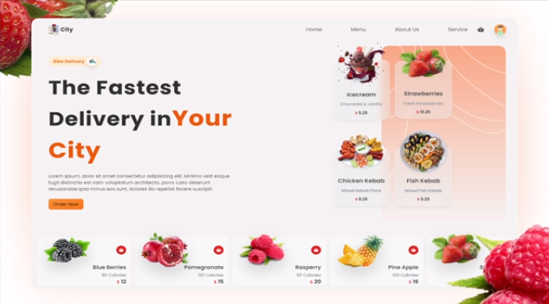

# City Food Express - Full-Stack D2C Restaurant Platform

> **Turnkey Direct-to-Consumer (D2C) Online Food Ordering and Restaurant Operations Platform**  
> Built with React 18, Redux, Node.js, Express.js, MongoDB Atlas, Stripe API, Cloudinary CDN, and Google OAuth 2.0.

[](https://city-food-express.vercel.app)
[](https://city-food-api.onrender.com)
[](https://reactjs.org/)
[](https://redux.js.org/)
[](https://nodejs.org/)
[](https://www.mongodb.com/atlas)
[](https://stripe.com/)
[](https://tailwindcss.com/)

---

## Live Deployments

* **Customer Storefront (Frontend)**: [https://city-food-express.vercel.app](https://city-food-express.vercel.app)
* **REST API Backend**: [https://city-food-api.onrender.com](https://city-food-api.onrender.com)
* **GitHub Repository**: [https://github.com/kodewizdom/fooddeliveryapp](https://github.com/kodewizdom/fooddeliveryapp)

---



---

## What is City Food Express?

Unlike commercial marketplace aggregators (such as Swiggy, Zomato, or UberEats) that charge steep 20% to 35% commissions on every order and withhold customer data:

**City Food Express is an independent, turnkey Direct-to-Consumer (D2C) food ordering and management platform.** It is designed as a standalone digital solution configured and handed over to an individual restaurant owner, allowing them to:
* **Own 100% of their revenue** with zero marketplace commission fees.
* **Directly own customer relationships**, order histories, and contact information.
* **Autonomously operate their digital storefront** through an intuitive no-code Admin Portal.

---

## Key Features

### Customer Storefront
* **138+ Dish Interactive Catalog**: High-resolution menu categorized into Biryanis, Pizzas, Curries, Chinese, Desserts, Fresh Fruits, and Drinks.
* **Instant Category Filtering**: Fast client-side category switching with responsive animations.
* **Optimistic Redux Cart (0ms Response)**: Fluid quantity adjustments, persistent item storage, and slide-out cart drawer.
* **Multi-Provider Authentication**: One-tap Google OAuth 2.0 (Google Identity Services) and JWT-secured Email/Password registration.
* **Stripe Hosted Checkout**: Secure, PCI-compliant online card payment processing with INR currency and address collection.
* **Fast Media Delivery**: Automatic WebP/AVIF format and perceptual quality compression powered by Cloudinary CDN (>80% image payload reduction).

### Restaurant Owner Admin Portal
* **Operations Dashboard**: Real-time business metrics, revenue counts, and order statistics.
* **Menu Management (CRUD)**: Add new dishes with image uploads, update dish names, adjust prices, and delete obsolete items.
* **Dynamic Categories with Cascade Deletion**: Automatic category detection from products, with safe cascade deletion that cleans up associated dishes atomically.
* **Live Kitchen Dispatch**: Track incoming orders from "preparing" in the kitchen to "delivered" at the customer's door.
* **User and Customer Management**: View registered customers and profile details.

---

## Architecture and Data Flow

```
                      +------------------------------------------+
                      |         Customer / Admin Browser         |
                      |   (React 18 + Redux + Framer Motion)    |
                      +--------------------+---------------------+
                                           |
                   HTTPS Requests          |  Asset Requests (Images)
             (REST API with JWT Header)    |  (Auto WebP / f_auto, q_auto)
                                           v
       +-----------------------------------+-----------------------------------+
       |                                                                       |
       v                                                                       v
+-------------------------------+                            +--------------------------------+
|       Vercel (Frontend)       |                            |         Cloudinary CDN         |
|  - SPA Rewrites (vercel.json) |                            |  - Media Delivery Optimization |
|  - Bundled Production Build   |                            |  - >80% Image Payload Reduction|
+---------------+---------------+                            +--------------------------------+
                |
                v  REST API Calls (/api/...)
+-------------------------------+
|     Render (Backend API)      |
|  - Node.js & Express.js       |
|  - JWT & Google OAuth 2.0     |
|  - Stripe Checkout Engine     |
+---------------+---------------+
                |
        +-------+-------+
        |               |
        v               v
+---------------+ +---------------+
| MongoDB Atlas | |  Stripe API   |
| (Mongoose DB) | | (Online Pay)  |
+---------------+ +---------------+
```

---

## Tech Stack and Ecosystem

| Layer | Technologies |
| :--- | :--- |
| **Frontend** | React 18.2.0, Redux (Core), React Router DOM v6, TailwindCSS 3.3, Framer Motion, Axios |
| **Backend** | Node.js (v20), Express.js 4.18 REST API, Mongoose 9.x |
| **Database** | MongoDB Atlas (Cloud NoSQL Document Database with connection pooling) |
| **Authentication** | Google Identity Services (GIS OAuth 2.0), JSON Web Tokens (JWT), Bcrypt password hashing |
| **Payments** | Stripe Checkout API (INR currency, hosted PCI-compliant payment portal) |
| **Media Delivery** | Cloudinary CDN with dynamic on-the-fly transformations (f_auto, q_auto, w_600) |
| **Cloud Hosting** | Vercel (Edge Frontend SPA) and Render (Node.js Web Service) |

---

## Repository Structure

```
restaurantappyarn/
├── client/                                    # Frontend React Application
│   ├── public/                                # HTML template, icons and SPA redirects
│   ├── src/
│   │   ├── api/index.js                       # Axios client and dynamic API base URL detection
│   │   ├── components/                        # UI components (Cart, Header, DBNewItem, SliderCard)
│   │   ├── context/                           # Redux actions, reducers and store
│   │   ├── containers/                        # Pages (Main, Login, Dashboard)
│   │   ├── utils/styles.js                    # Cloudinary CDN dynamic image optimizer
│   │   └── App.js                             # Root component and synchronous session hydration
│   ├── .npmrc                                 # legacy-peer-deps=true for npm peer resolution
│   └── vercel.json                            # Vercel SPA rewrite rules and install command
│
├── server/
│   └── functions/                             # Backend Express Application
│       ├── models/index.js                    # Mongoose Schemas (User, Product, Cart, Order)
│       ├── routes/
│       │   ├── user.js                        # Auth routes (Signup, Login, Google-Login, JWT)
│       │   └── products.js                    # Catalog CRUD, Cart sync, Stripe session, Orders
│       ├── server.js                          # Express app entry, MongoDB Atlas connect and CORS
│       └── package.json                       # Backend dependencies and start scripts
│
├── render.yaml                                # Render Cloud deployment blueprint
└── README.MD                                  # Project documentation
```

---

## Getting Started (Local Development)

### Prerequisites
* **Node.js**: >= 18.x
* **npm** or **yarn**
* **MongoDB Atlas** connection string
* **Stripe** account API keys
* **Cloudinary** cloud credentials
* **Google Cloud Console** OAuth 2.0 Client ID

### 1. Clone the Repository
```bash
git clone https://github.com/kodewizdom/fooddeliveryapp.git
cd fooddeliveryapp
```

### 2. Setup the Backend Server
```bash
cd server/functions

# Install dependencies
npm install

# Create environment configuration
cp .env.example .env # or create .env manually
```

Configure your `server/functions/.env` file:
```env
PORT=10000
MONGO_URI=your_mongodb_atlas_connection_string
JWT_SECRET=your_super_secret_jwt_key
STRIPE_SECRET_KEY=sk_test_your_stripe_secret_key
CLIENT_URL=http://localhost:3000
```

Start the backend server:
```bash
npm start
# Server runs on http://localhost:10000
```

### 3. Setup the Frontend Client
Open a new terminal window:
```bash
cd client

# Install dependencies (using legacy peer deps for React 18 compatibility)
npm install --legacy-peer-deps

# Create environment configuration
cp .env.example .env # or create .env manually
```

Configure your `client/.env` file:
```env
REACT_APP_BASE_URL=http://localhost:10000
REACT_APP_GOOGLE_CLIENT_ID=your_google_oauth_client_id.apps.googleusercontent.com
REACT_APP_ADMIN_EMAIL=admin@restaurant.com
```

Start the React development server:
```bash
npm start # or yarn start
# Application opens at http://localhost:3000
```

---

## Environment Variables Reference

### Backend (`server/functions/.env`)
| Variable | Description |
| :--- | :--- |
| `PORT` | Local server port (Default: 10000) |
| `MONGO_URI` | MongoDB Atlas SRV connection string |
| `JWT_SECRET` | Secret key used to sign and verify 30-day JWT tokens |
| `STRIPE_SECRET_KEY` | Stripe secret key (sk_test_... or sk_live_...) |
| `CLIENT_URL` | URL of the frontend for Stripe checkout redirect callbacks |

### Frontend (`client/.env`)
| Variable | Description |
| :--- | :--- |
| `REACT_APP_BASE_URL` | Backend REST API URL (defaults to Render in production) |
| `REACT_APP_GOOGLE_CLIENT_ID` | Google Identity Services OAuth 2.0 Client ID |
| `REACT_APP_ADMIN_EMAIL` | Designated administrator email address for RBAC elevation |

---

## REST API Endpoints

### User and Authentication (`/api/users`)
* `POST /api/users/signup`: Register with Email and Password (Bcrypt hashed, 30-day JWT).
* `POST /api/users/login`: Sign in with Email and Password.
* `POST /api/users/google-login`: Verified Google OAuth 2.0 profile sign-in.
* `GET /api/users/jwtVerification`: Verify JWT token and hydrate user session.
* `GET /api/users/all`: List all registered users (Admin only).
* `PUT /api/users/update-profile/:user_id`: Update delivery address and contact details.

### Products, Cart and Orders (`/api/products`)
* `GET /api/products/all`: Fetch all active food dishes with Cloudinary CDN links.
* `POST /api/products/create`: Create a new dish with category assignment (Admin only).
* `DELETE /api/products/delete/:productId`: Delete an individual dish (Admin only).
* `DELETE /api/products/deleteCategory/:categoryName`: Cascade delete an entire category and all its items (Admin only).
* `GET /api/products/getCartItems/:user_id`: Fetch customer's persistent cart.
* `POST /api/products/addToCart/:user_id`: Add dish to cart or increment quantity.
* `POST /api/products/updateCart/:user_id`: Update cart item quantities or remove item.
* `POST /api/products/create-checkout-session`: Parallelized Stripe Checkout Session creation (Promise.all).
* `GET /api/products/orders`: Fetch live orders with item snapshots and customer details.
* `POST /api/products/updateOrder/:order_id`: Update kitchen fulfillment status (preparing -> delivered).

---

## Production Deployment

* **Frontend (Vercel)**:
  * Automatically deployed via Git push.
  * Configured with `vercel.json` for SPA rewrites (`/(.*)` -> `/index.html`) to ensure clean URL reloads without 404 errors.
  * Uses `.npmrc` with `legacy-peer-deps=true` for reproducible dependency tree resolution.
* **Backend (Render)**:
  * Deployed as a Node.js web service running `node server.js` on port 10000.
  * Universal CORS reflection configured for secure cross-origin communication.
  * Connects to MongoDB Atlas using pooled connections (`maxPoolSize: 10`).

---

## License

This project is licensed under the [MIT License](LICENSE).